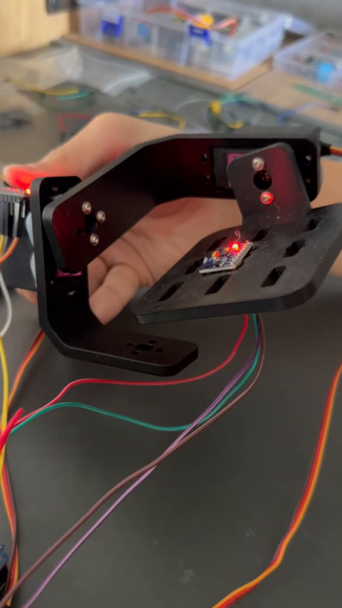

# Arduino ilə iki oxlu gimbal stabilizatoru

[English](README.md) · [Sistem quruluşu](docs/system-design.md) · [Riyazi əsaslar](docs/mathematics.md) · [Sınaqlar](docs/testing.md)

İki MPU6050 inersial sensorundan, fırlanma matrisləri ilə fəza vəziyyətinin qiymətləndirilməsindən, əlaqəli həndəsi oynaq həlledicisindən, qabaqlayıcı kompensasiyadan (feedforward) və PD əks əlaqəsindən istifadə edən eksperimental Arduino Uno gimbalı. Sistem platformanın ağırlıq qüvvəsinə nəzərən roll və pitch bucaqlarını idarə etmək üçün hazırlanıb.

**[Nümayiş videoları və qurğunun şəkilləri](media/README.md)** — təqdim olunmuş masaüstü nümayişlərdə mexanizm əl ilə hərəkət etdirilir; bu materiallar stabilləşdirmə dəqiqliyini rəqəmlərlə müəyyən etmir.



*02 nömrəli videonun 0,5-ci saniyəsindən götürülmüş həqiqi kadr: platforma, ətraf çərçivə və görünən iki sensor modulu. Mediada görünən şəxslərin razılığı təsdiqlənənədək materiallar GitHub-da dərc edilməyəcək.*

Təqdim olunmuş yekun proqram [firmware/gimbal_stabilizer/gimbal_stabilizer.ino](firmware/gimbal_stabilizer/gimbal_stabilizer.ino) faylında bayt səviyyəsində dəyişdirilmədən saxlanılıb və Arduino Uno üçün uğurla kompilyasiya olunub. Müəllif qurğunu işlək prototip kimi təqdim edir; mövcud sübutlar vizual nümayişlərlə məhdudlaşır, ölçmə cihazları ilə toplanmış performans məlumatları yoxdur.

## Məqsəd və mühəndislik məsələsi

Məqsəd baza hərəkət edərkən platformanın ağırlıq qüvvəsinə nəzərən tələb olunan vəziyyətini saxlamaqdır. Xarici roll mexanizmi daxili pitch mexanizmini daşıyır. Buna görə birgə hərəkətdə fırlanmaların ardıcıllığı əhəmiyyətlidir: proqram baza roll və pitch bucaqlarını iki müstəqil servo düzəlişi kimi götürmək əvəzinə, iç-içə mexanizmin həndəsəsini həll edir.

Baza IMU-su həndəsi kompensasiya üçün ağırlıq istiqamətini verir. Platforma IMU-su isə nəticədə yaranan vəziyyəti və platforma koordinat sistemində bucaq sürətlərini ölçərək əks əlaqəni təmin edir. Sensorların heç biri mütləq istiqamət istinadı vermir; iki oxlu mexanizm yaw bucağını idarə etmir.

## Komponentlər və qoşulmalar

| Komponent | Sayı və rolu |
|---|---|
| Arduino Uno R3 | 1; hesablama, I²C və servo siqnalları |
| MPU6050 modulu | 2; platforma və bazanın inersial ölçmələri |
| MG996R servomühərriki | 2; müəllifin göstərdiyi roll və pitch aktuatorları |
| İki oxlu gimbal çərçivəsi | Xarici roll pilləsi daxili pitch pilləsini daşıyır |
| 18650 litium-ion elementi | Prototipin bildirilən qidalanma sistemində 2 ədəd |
| Gərginlikazaldıcı DC–DC çevirici və birləşdirici naqillər | Bildirilən qidalanma və prototip bağlantıları |

| Qoşulma | Konfiqurasiya |
|---|---|
| Platforma MPU6050 | `0x68`; AD0 aşağı məntiqi səviyyədə |
| Baza MPU6050 | `0x69`; AD0 uyğun məntiqi gərginlikdə yüksək səviyyədə |
| Hər iki SDA xətti | Uno A4 / SDA |
| Hər iki SCL xətti | Uno A5 / SCL |
| Roll servo siqnalı | Uno D10 |
| Pitch servo siqnalı | Uno D9 |
| Siqnal istinadı | Uno, sensorlar və servo qidalanması arasında ümumi GND |

Ünvanlar və servo pinləri mənbə kodunda təsdiqlənir. A4/A5 və AD0 səviyyələri bu interfeyslərin tələb etdiyi qoşulmalardır; **naqillərin bütövlüyü ölçülərək yoxlanılmayıb**. Şəkillər bütün bağlantıları, batareyaların ardıcıl və ya paralel qoşulmasını, qoruma sxemini və çeviricinin çıxış gərginliyini müəyyən etmir. Qurğunu təkrarlamazdan əvvəl [qoşulma və qidalanma qeydlərini](docs/wiring.md) oxuyun. Servolar üçün uyğun ayrıca tənzimlənən qida mənbəyi istifadə olunmalıdır; onların yük cərəyanı Uno-nun 5 V pinindən keçirilməməlidir.

## Proqramın iş prinsipi

1. Hər iki MPU6050 ±2 g və ±250°/s diapazonlarına qurulur; 500 hərəkətsiz nümunə ilə giroskopun sıfır sürüşməsi qiymətləndirilir.
2. Təqdim olunmuş akselerometr kalibrləməsi və hər sensorun irəli–sağa–aşağı (FRD) koordinat çevirməsi tətbiq edilir.
3. İlkin fırlanma matrisləri ağırlıq istiqamətindən hesablanır. Giroskop məlumatları Rodrigues düsturu ilə inteqrasiya olunur. Təcilin modulu ciddi şəkildə 0,80 g ilə 1,20 g arasında olduqda ağırlıq vektorlarının vektorial hasili əsasında düzəliş verilir.
4. Bazanın və hədəf platformanın ağırlıq vektorlarından istifadə etməklə `R_joint = Rx(roll) Ry(pitch)` ideal mexaniki modeli həll edilir.
5. Bazanın hərəkəti üçün qabaqlayıcı kompensasiya, hədəf dəyişikliyinin həndəsi təsiri, platformanın bucaq xətası və bucaq sürətinə görə sönümləmə birləşdirilir.
6. Hər iki aktiv servo hədəfi yoxlanıldıqdan sonra komandalar verilir; avtomatik komandanın dəyişmə sürəti 80°/s ilə məhdudlaşdırılır.

İdarəetmə yeniləmələri ən azı 20 ms aralıqla planlaşdırılır. Bu, nominal 50 Hz hədəfidir, ölçülmüş sabit icra tezliyi deyil. Vəziyyət məlumatı **115200 baud** sürətində hər 200 ms-dən bir planlaşdırılır.

Hər aktiv ox üçün servo komandasının hədəfi:

$$u^*=u_{ref}+0.85\,\Delta(q_{hold},q_{ref})+\Delta(q_{want},q_{hold})-0.30\,e-0.050\,\omega$$

Burada `Δ` bucaq fərqini ±180° aralığına gətirir, `q` həndəsi oynaq bucağıdır, `e` ölçülmüş platforma bucağı ilə hədəf arasındakı fərqdir, `ω` isə platforma koordinat sistemində °/s ilə bucaq sürətidir. Oynaq bucaqları ilə servo-komanda bucaqları arasında müvəqqəti 1:1 uyğunluq qəbul edilir; bu, ölçülərək təsdiqlənmiş aktuator kalibrləməsi deyil. Koordinat qaydaları və həlledicinin seçdiyi budaq [riyazi izahda](docs/mathematics.md) verilir.

## Kompilyasiya və lövhəyə yükləmə

Arduino IDE-də `firmware/gimbal_stabilizer/gimbal_stabilizer.ino` faylını açın, **Arduino Uno** lövhəsini seçin, **Servo** kitabxanasını quraşdırın və qoşulmuş lövhənin portunu göstərin. `Wire` Arduino AVR Boards paketinə daxildir; ayrıca MPU6050 kitabxanası tələb olunmur.

Yoxlanılmış asılılıq versiyaları ilə CLI əmrləri:

```sh
arduino-cli core update-index
arduino-cli core install arduino:avr@1.8.8
arduino-cli lib install Servo@1.3.0
arduino-cli compile --fqbn arduino:avr:uno --warnings all firmware/gimbal_stabilizer
arduino-cli board list
arduino-cli upload --fqbn arduino:avr:uno --port <YOUR_PORT> firmware/gimbal_stabilizer
```

**Nəticə:** Arduino CLI 1.6.0, AVR core 1.8.8, avr-g++ 7.3.0 və Servo 1.3.0 ilə kompilyasiya uğurludur. Flash yaddaş: **25 430 / 32 256 bayt (78%)**; qlobal dəyişənlər üçün RAM: **784 / 2 048 bayt (38%)**. Dörd xəbərdarlıq Arduino nüvəsinin `new.cpp` faylındadır. Bu yoxlama zamanı fiziki lövhəyə yükləmə və aparat üzərində icra aparılmayıb. [Yoxlama hesabatı](docs/validation.md).

## Başlanğıc və serial əmrləri

Mexanizmin hərəkəti üçün boş sahə saxlayın: avtomatik idarəetmə HOLD rejimində başlasa da, başlanğıcda hər iki servoya 90° komandası verilir. Giroskop kalibrlənərkən qurğunu tam hərəkətsiz saxlayın. `READY / HOLD` mesajını və etibarlı sensor oxunuşlarını gözləyin. Lazım olduqda HOLD rejimində `0` göndərin, mexanizm dayandıqdan sonra `z` göndərin. `z` mexaniki istinadı yadda saxlayır və **cari vəziyyəti hədəfə çevirir**. Üfüqi vəziyyət üçün `l`, hər iki oxu aktivləşdirmək üçün `a` göndərin. Sınaqlara kiçik hərəkətlərlə başlayın.

| Əmr | Təsiri və şərti |
|---|---|
| `s` | Hər iki oxun avtomatik yenilənməsini dayandırır; servo PWM siqnalları qalır |
| `0` | Yalnız HOLD: hər iki servoya dərhal 90° verir; dayandıqdan sonra `z` göndərin |
| `z` | Yalnız HOLD: cari servo/vəziyyət istinadını saxlayır; etibarlı oxunuşlar və bütün giroskop komponentləri üçün ≤1,5°/s tələb olunur |
| `l` və ya `L` | Roll/pitch üçün 0°/0° tələb edir; AUTO rejimini aktivləşdirmir |
| `t 15 20` | Roll 15°, pitch 20° tələb edir; yeni sətirlə tamamlanmalıdır; hər hədəf ±30° daxilində və həndəsi baxımdan mümkün olmalıdır |
| `r` | HOLD-dan yalnız roll üzrə avtomatik rejimə keçir |
| `p` | HOLD-dan yalnız pitch üzrə avtomatik rejimə keçir |
| `a` | HOLD-dan hər iki ox üzrə avtomatik rejimə keçir |

Bufer boş olduqda tək simvollu əmrlər yeni sətir tələb etmir. Avtomatik rejimlər arasında keçid üçün əvvəl `s` göndərin. Hədəf HOLD və AUTO rejimlərində dəyişdirilə bilər, lakin etibarlı sensor məlumatı tələb olunur. Başlanğıcda və `z` ilə götürülən istinada ±30° istifadəçi-hədəfi yoxlaması tətbiq edilmir. [Ətraflı istismar təlimatı](docs/operation.md) buferin davranışını, telemetriyanı və nasazlıq rejimlərini izah edir.

## İş məhdudiyyətləri

- Bazanın saxlanılmış istinada nəzərən roll və ya pitch fərqi **90°-dən böyük** olduqda avtomatik rejimə keçid bloklanır və ya idarəetmə HOLD-a keçir.
- Həndəsi həlledici ayrıca `g.z ≥ 0.20`, `sqrt(g.y²+g.z²) ≥ 0.20`, mümkün hədəf və ±89° daxilində oynaq həlli tələb edir. Buna görə sistem ±90° istinad həddinə çatmamış dayana bilər.
- Avtomatik servo hədəfləri roll üçün **45–180°**, pitch üçün **15–165°** komanda aralığındadır. Aktiv hədəflərdən biri həddi aşarsa, hər hansı servo yazısından əvvəl hər iki avtomatik ox dayandırılır.
- Oxunuş və ya zamanlama xətasında avtomatik komandalar dondurulur. Qısa nasazlıq 100 ms-lik pəncərədə beş ardıcıl düzgün nümunədən sonra bərpa oluna bilər. Daha uzun bərpa üçün 800 ms təmiz oxunuş və ən azı 20 düzgün nümunə tələb olunur. Əvvəlki AUTO rejimi avtomatik davam edə bilər.

HOLD servoların qidasını kəsmir və müstəqil aparat qəza dayandırıcısı deyil. [Məhdudiyyətlər və kodun təhlili](docs/limitations.md).

## Nümayişlər və sübutların hüdudları

Videolarda qidalanan qurğu, çərçivənin əl ilə hərəkət etdirilməsi və platformanın çərçivəyə nəzərən hərəkəti görünür. Kamera hərəkəti, əl təması və sinxron telemetriyanın olmaması dəqiqlik və qərarlaşma müddəti barədə əsaslandırılmış rəqəm verməyə imkan yaratmır. Çəkiliş zamanı hansı proqram versiyasının və rejimin işlədiyi müstəqil şəkildə təsdiqlənməyib.

Şəkillərdə çərçivə, iki sensor modulu və açıq naqillər görünür. Ayrıca fotolar tapşırıqda görünürdü, lakin onların orijinal faylları icra mühitinə əlçatan deyildi. Faktiki daxil edilən materiallar [media siyahısında](media/README.md), müşahidələr isə [sınaq qeydlərində](docs/testing.md) göstərilir.

## Məhdudiyyətlər və növbəti addımlar

Xətti təcil akselerometr düzəlişinə, o cümlədən modul yoxlamasının daxilində, təsir edə bilər. Xarici istiqamət istinadı olmadan giroskopun yaw qiyməti sürüşür. Sensorların yerləşməsi, servo istiqaməti/sıfırı/miqyası, mexaniki boşluq, moment ehtiyatı və oxların birgə hərəkəti ölçülməlidir. Əmsallar sabitdir, 1:1 oynaq–komanda uyğunluğu isə ilkin fərziyyədir. Qidalanma topologiyası və cərəyan ehtiyatı təsdiqlənməyib. Ölçülmüş xəta, faydalı yük, tezlik zolağı, batareya müddəti və dayanıqlılıq barədə iddia irəli sürülmür.

Prioritetlər sensor və servo uyğunluqlarını ölçmək, xarici bucaq istinadı ilə sinxron telemetriya toplamaq, birgə ox hərəkətini və pilləvari hədəf dəyişmələrini sınaqdan keçirmək, qidalanmanı və nasazlıqdan bərpanı yoxlamaqdır. Mümkün proqram problemləri ayrıca sənədləşdirilib; işlək proqram dəyişdirilməyib və yenidən sazlanmayıb.

## Sənədlər

- [Sistem quruluşu](docs/system-design.md), [qoşulmalar](docs/wiring.md), [riyazi əsaslar](docs/mathematics.md)
- [İstismar](docs/operation.md), [sınaqlar](docs/testing.md), [məhdudiyyətlər](docs/limitations.md), [yoxlama](docs/validation.md)
- [Professor üçün layihə xülasəsi](docs/project-summary.md), [CV və LinkedIn mətnləri](docs/cv-snippets.md)

Ətraflı texniki sənədlər ingilis dilindədir. Açıq mənbə lisenziyası seçilməyib; dərc edilməsi özlüyündə təkrar istifadə lisenziyası vermir. Sahibinin razılığı olmadan repozitoriya ictimai edilməməlidir.
