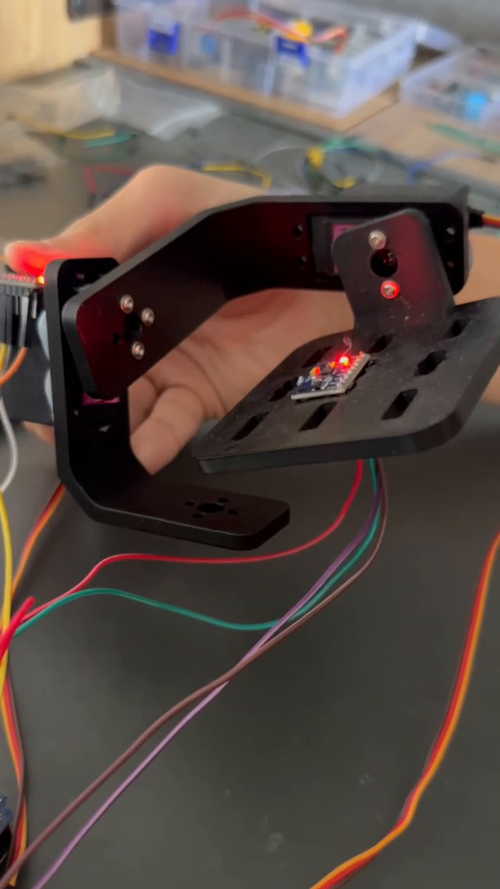

# Arduino Two-Axis Gimbal Stabilizer

[Azərbaycanca](README.az.md) · [Technical design](docs/system-design.md) · [Mathematics](docs/mathematics.md) · [Testing](docs/testing.md)

An experimental Arduino Uno gimbal that combines two MPU6050 inertial sensors, rotation-matrix orientation estimation, a coupled geometric joint solver, and feedforward plus PD feedback to control a platform's roll and pitch relative to gravity.

**[Demonstration and hardware photographs](media/README.md)** — supplied bench demonstrations show the assembled mechanism being moved by hand; they do not establish numerical stabilization accuracy.



*Authentic frame extracted at 0.5 s from demonstration 02, showing the platform, surrounding frame and two visible sensor modules. Media publication awaits confirmation of permission for everyone shown.*

The final supplied sketch is preserved byte for byte in [firmware/gimbal_stabilizer/gimbal_stabilizer.ino](firmware/gimbal_stabilizer/gimbal_stabilizer.ino). It compiles for Arduino Uno. This is a working prototype reported by its builder, with limited visual evidence and no instrumented performance dataset.

## Objective and engineering problem

The goal is to counter changes in base attitude while maintaining a requested gravity-relative platform orientation. The outer roll mechanism carries the inner pitch mechanism. Consequently, combined motion depends on rotation order: the software solves the nested geometry rather than treating base roll and pitch as independent servo offsets.

Two IMUs serve different purposes: the base sensor supplies the gravity direction for geometric compensation; the platform sensor measures the resulting attitude and body angular rates for feedback. Neither sensor provides an absolute heading reference, and this two-axis mechanism does not regulate yaw.

## Hardware and connections

| Component | Quantity / role |
|---|---|
| Arduino Uno R3 | 1; controller, I²C and servo signals |
| MPU6050 module | 2; platform and base inertial sensing |
| MG996R servomotor | 2; roll and pitch actuation, as identified by the builder |
| Two-axis frame | Outer roll stage carrying inner pitch stage |
| 18650 lithium-ion cell | 2 in the reported prototype power system |
| Buck converter and jumper wires | Reported power conversion and prototype interconnects |

| Connection | Configuration |
|---|---|
| Platform MPU6050 | `0x68`; AD0 low |
| Base MPU6050 | `0x69`; AD0 high at a compatible logic voltage |
| Both SDA lines | Uno A4 / SDA |
| Both SCL lines | Uno A5 / SCL |
| Roll servo signal | Uno D10 |
| Pitch servo signal | Uno D9 |
| Signal reference | Common ground between Uno, sensors and servo supply |

Addresses and servo pins are verified in the sketch. A4/A5 and AD0 states are the required Uno/MPU6050 wiring implied by those interfaces, **not a continuity-tested wiring survey**. Photographs do not establish every jumper connection, supply voltage, battery arrangement, protection circuit or converter setting. See [wiring and power](docs/wiring.md) before reproducing the build; use a suitable separate regulated servo supply, not the Uno's 5 V pin for servo load current.

## How the software works

1. Configure both MPU6050s for ±2 g and ±250°/s; estimate gyro bias from 500 stationary samples.
2. Apply the supplied accelerometer calibration and each sensor's Forward–Right–Down axis mapping.
3. Initialize each orientation matrix from gravity. Integrate body gyro rates with Rodrigues' rotation formula; use a gravity-vector cross-product correction when acceleration magnitude is strictly between 0.80 g and 1.20 g.
4. Solve the ideal nested joint model `R_joint = Rx(roll) Ry(pitch)` using the base gravity vector and desired platform gravity vector.
5. Combine geometric base-motion feedforward, a geometric target-change term, platform attitude error and platform body-rate damping.
6. Check both active servo goals before writing either motor; limit automatic command slew to 80°/s.

The controller schedules updates at intervals of at least 20 ms; this is a nominal 50 Hz target, not a measured sustained loop rate. Status output is scheduled every 200 ms at **115200 baud**.

For each active axis, the command goal is:

$$u^*=u_{ref}+0.85\,\Delta(q_{hold},q_{ref})+\Delta(q_{want},q_{hold})-0.30\,e-0.050\,\omega$$

Here `Δ` wraps differences to ±180°, `q` is a geometric joint angle in degrees, `e` is measured platform angle minus target angle, and `ω` is platform body rate in °/s. Joint degrees are provisionally mapped 1:1 to servo-command degrees. This is an uncalibrated actuator assumption. The [mathematical derivation](docs/mathematics.md) explains coordinate conventions, the solver branch and the distinction between body rates and Euler-angle derivatives.

## Build and upload

Open `firmware/gimbal_stabilizer/gimbal_stabilizer.ino` in Arduino IDE, select **Arduino Uno**, install the **Servo** library, select the connected board's port, and compile/upload. `Wire` is supplied with Arduino AVR Boards; no MPU6050 library is needed.

Equivalent CLI commands, with the validated dependency versions:

```sh
arduino-cli core update-index
arduino-cli core install arduino:avr@1.8.8
arduino-cli lib install Servo@1.3.0
arduino-cli compile --fqbn arduino:avr:uno --warnings all firmware/gimbal_stabilizer
arduino-cli board list
arduino-cli upload --fqbn arduino:avr:uno --port <YOUR_PORT> firmware/gimbal_stabilizer
```

**Build result:** Arduino CLI 1.6.0, AVR core 1.8.8, avr-g++ 7.3.0, Servo 1.3.0: **passed**; flash **25,430 / 32,256 bytes (78%)**, global RAM **784 / 2,048 bytes (38%)**. Four warnings originate in the core's `new.cpp`. Upload and hardware execution were not performed during this review. [Full validation record](docs/validation.md).

## Startup and serial commands

Allow physical clearance: startup attaches both servos and commands 90° even though automatic control starts in HOLD. Keep the mechanism completely still during gyro calibration. Wait for `READY / HOLD` and healthy readings. In HOLD, `0` centers both servos immediately; after settling, `z` captures the mechanical reference **and makes the current attitude the target**. Send `l` to request level, then `a` to enable both axes. Start with small motions within verified mechanical travel.

| Command | Action / requirement |
|---|---|
| `s` | Stop automatic updates to both axes; servo PWM remains active |
| `0` | HOLD only: immediately command both servos to 90°; allow settling, then `z` |
| `z` | HOLD only: capture current servo/reference attitude; requires healthy readings and all gyro components ≤1.5°/s |
| `l` or `L` | Request platform roll/pitch 0°/0°; does not arm AUTO |
| `t 15 20` | Request roll 15°, pitch 20°; terminate with newline; both targets must be within ±30° and geometrically reachable |
| `r` | From HOLD: automatic roll only |
| `p` | From HOLD: automatic pitch only |
| `a` | From HOLD: automatic control of both axes |

Single-letter commands need no newline when the parser is empty. Send `s` before changing automatic modes. Target changes are allowed in HOLD or AUTO but require healthy sensor data. Startup/`z` captures are not subjected to the ±30° user-target check. Full parser behavior, telemetry, and fault handling: [operation guide](docs/operation.md).

## Operating limits

- Base roll/pitch deviations **greater than 90°** from the saved reference block arming or latch HOLD during automatic operation.
- The geometric solver separately requires base down-vector `g.z ≥ 0.20`, `sqrt(g.y²+g.z²) ≥ 0.20`, an admissible target and joint solutions within ±89°. These can stop operation before the ±90° reference-relative cutoff.
- Automatic goal ranges are roll **45–180°**, pitch **15–165°** in servo-command units. An out-of-range active goal stops both automatic controllers before either write; it is not silently clamped.
- Failed sensor reads or rejected timing freeze automatic commands. Brief faults can recover after five valid samples within a 100 ms window; longer recovery requires 800 ms of clean readings and at least 20 good samples. The previous AUTO mode can resume automatically.

HOLD retains servo pulses and is not a power-off or independent hardware emergency stop. See [limitations and review findings](docs/limitations.md).

## Demonstrations and evidence

The supplied clips show a powered assembly, manual changes in frame orientation, and relative motion between the platform and surrounding frame. Camera motion, hand contact and the absence of synchronized telemetry prevent a defensible numerical accuracy or settling-time claim. The exact firmware running during recording and the selected modes are not independently established.

The photographs show the frame, two sensor modules and exposed wiring. The standalone photos were visible in the task, but their original image files were not available to the execution workspace; the media record states which assets are actually included. See [media inventory](media/README.md) and [observations by clip](docs/testing.md).

## Limitations and next steps

Accelerometer correction can be disturbed by linear acceleration, even inside the magnitude gate. Gyro heading drifts without an external yaw reference. Sensor mounting alignment, servo direction/zero/scale, backlash, available torque and combined-axis behavior need characterization. Gains are fixed, and the 1:1 joint-to-command mapping is provisional. Power topology and current margins remain unverified. No measured error, payload, bandwidth, battery runtime or robustness claim is made.

Priority improvements are to measure axis alignment and servo mappings, log synchronized platform/base telemetry against an external angle reference, test combined-axis and target-step behavior, and validate power integrity and fault recovery. Potential software issues are documented separately; the working sketch has not been retuned or rewritten.

## Documentation

- [System design](docs/system-design.md), [wiring](docs/wiring.md), [mathematics](docs/mathematics.md)
- [Operation](docs/operation.md), [testing](docs/testing.md), [limitations](docs/limitations.md), [validation](docs/validation.md)
- [Professor-ready summary](docs/project-summary.md), [CV and LinkedIn text](docs/cv-snippets.md)

No open-source license has been selected. Publication does not itself grant a reuse license. Repository visibility must remain private until the owner approves making it public.
