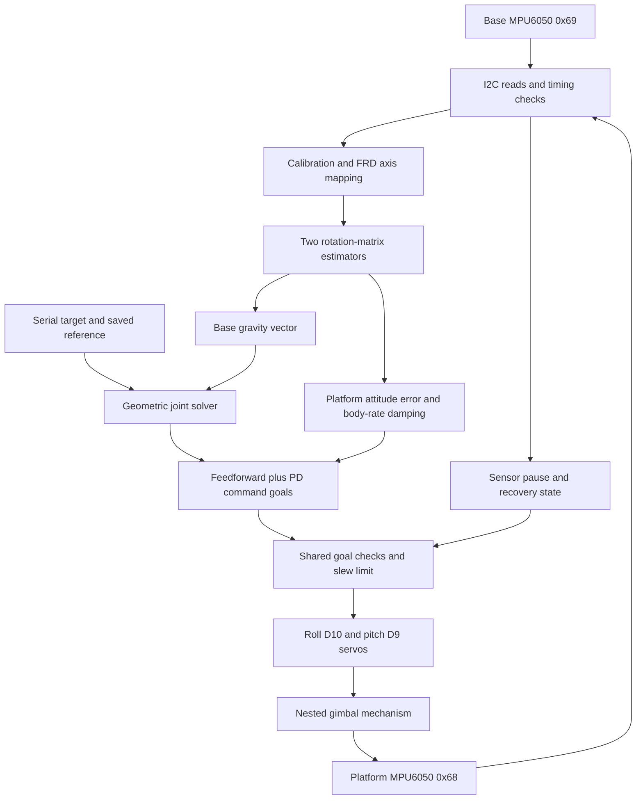

# System design

[README](../README.md) · [Mathematics](mathematics.md) · [Wiring](wiring.md)

## Mechanical and sensor arrangement

The builder specifies an outer roll mechanism carrying an inner pitch mechanism. The platform IMU (`0x68`) is attached to the moving platform; the base IMU (`0x69`) is intended to follow the supporting base. The visible modules are consistent with that intended arrangement, but exact mounting angles and mechanical axis alignment have not been measured. Do not infer sensor addresses from their appearance alone.

The ideal mechanical transform maps platform-frame vectors into the base frame as `Rx(qr) Ry(qp)`. This joint transform is distinct from the estimator's initial Euler construction `Ry(pitch) Rx(roll)`. Multiplication order matters.

## Data path

`setup()` writes `PWR_MGMT_1=0x01`, `GYRO_CONFIG=0x00`, and `ACCEL_CONFIG=0x00`. The sketch does not configure the digital low-pass filter or sample-rate divider explicitly. A 14-byte burst starting at `0x3B` reads acceleration, skips temperature, and reads angular velocity. Conversion factors are 16,384 LSB/g and 131 LSB/(°/s).

Gyro calibration averages 500 samples per sensor in native coordinates, with a 5 ms delay per paired sample and a preceding 1 s stillness delay. The fixed accelerometer bias and scale arrays are described by the source as measured calibration; no supporting calibration dataset was supplied.

Platform FRD mapping is `(-x, y, -z)`; base mapping is `(-y, -x, -z)`. Both are proper rotations, but correct physical alignment of the base mapping is explicitly approximate in the code. Accelerometer bias/scale correction happens before mapping. Native-frame gyro bias is subtracted before mapping.

The two sensors are read sequentially, not synchronously latched. Both must read successfully before either orientation is updated. If the platform read fails, the short-circuit expression skips the base read. The same measured `dt` is used for both updates.

## Scheduling and state

The main loop reads both IMUs, checks `0 < dt < 0.10 s`, updates both estimators, advances fault recovery, processes serial input, and attempts control at intervals ≥20,000 μs. It prints status at intervals ≥200 ms and delays 3 ms. These are software scheduling thresholds, not measured rates.

The four user modes are HOLD, ROLL, PITCH and BOTH. A separate sensor-pause flag prevents automatic command updates without replacing the selected mode. A sustained outage is marked after 1,000 ms; successful recovery can resume the previous mode. Geometry, base-angle and servo-range faults set HOLD and require explicit re-arming.

The position loops inside the hobby servos are not implemented here. The Arduino sends integer angle commands without joint encoder feedback. Platform attitude is the outer loop's feedback signal. Commanded position, measured physical joint position and measured platform attitude must not be treated as interchangeable.
