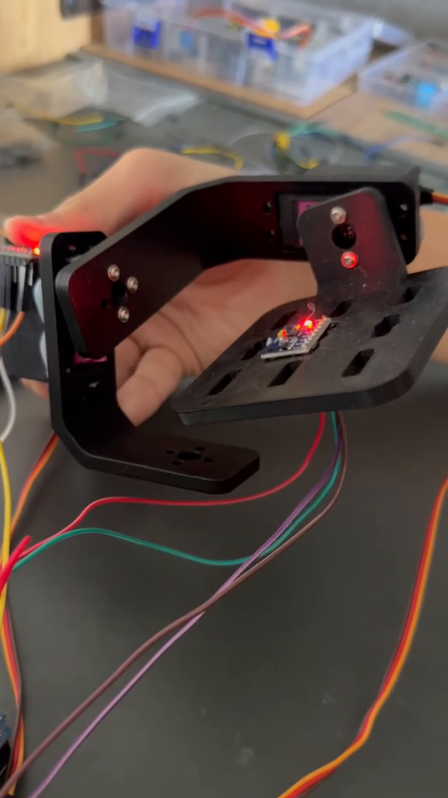
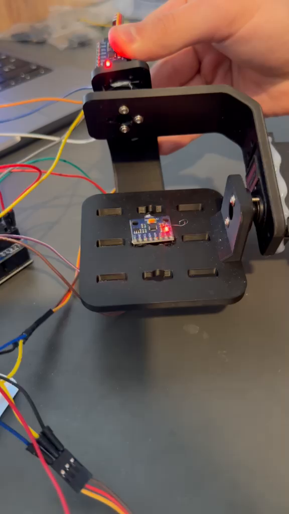

# Demonstrations and media provenance

[English README](../README.md) · [Azərbaycanca](../README.az.md) · [Testing record](../docs/testing.md)

**Publication status:** these files are prepared for local review. Publishing media to GitHub is pending the owner's confirmation that everyone shown has permission to be included. Hands and parts of people appear in the videos; the audio has not been reviewed for personal information. The repository must remain private unless the owner separately approves public visibility.

## Demonstrations

- [Demonstration 01 — manual movement of the assembly](demo-01.mp4), 13.933 s, 2.90 MB.
- [Demonstration 02 — repeated hand-held changes of frame orientation](demo-02.mp4), 18.033 s, 3.79 MB.

These links point to the included MP4 files. GitHub may offer download rather than inline playback for committed video files. No external video host or public sharing link has been created. The files are small enough for ordinary Git storage; Git LFS and an external host are unnecessary for this delivery. A future larger collection could use a video host with explicit sharing settings, but a link should only be added after upload and verification.

## Selected stills

*Demonstration 02 at 0.5 s. The platform-mounted sensor and a second sensor on the surrounding assembly are visible. The hand is supporting the mechanism. A still image does not demonstrate closed-loop performance.*

*Demonstration 01 at 1.0 s. The front view shows the platform, brackets, indicator lights and exposed wiring. Sensor identities and addresses come from the supplied implementation and builder description, not from visual identification of I²C addresses.*

## Provenance and authenticity

| Repository file | Original uploaded file |
|---|---|
| `demo-01.mp4` | `WhatsApp Video 2026-11-14 at 13.10.17.mp4` |
| `demo-02.mp4` | `WhatsApp Video 2026-11-14 at 13.30.04.mp4` |

The videos are byte-for-byte copies with neutral repository filenames. Container inspection found format/codec information, an orientation display matrix and generic language/vendor tags, but no GPS or personal author metadata. The encoded video is 1024×576 at approximately 30 fps with a rotation tag for portrait display; both files include AAC audio. No audio statements are used as technical evidence.

The PNG images are decoded full-frame extracts, with the source's display rotation honored and metadata excluded. They have not been cropped, composited, retouched, generated or altered to simulate behavior. They are explicitly video stills, not substitutes falsely represented as the supplied standalone photographs. Original filenames, sizes and SHA-256 values are recorded in [manifest.json](manifest.json).

The overhead and front/side photographs in the conversation were visually reviewed, but no downloadable file pointers for those original images were exposed to the workspace. They are therefore not included as invented or reconstructed image files. Their original files are needed to add them to the repository. The front/side photograph also shows a person's hand and requires the same permission check before publication.
